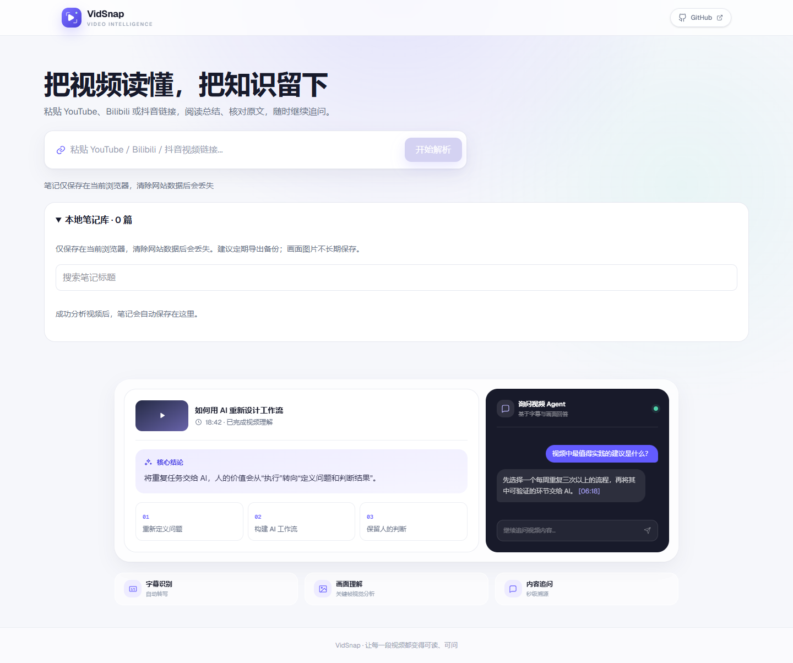
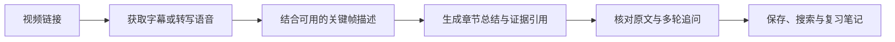

# VidSnap · AI 视频学习助手

VidSnap 把 YouTube、Bilibili 和抖音视频整理成可阅读、可追问的学习笔记。粘贴视频链接，即可查看章节总结、核对字幕与画面依据，并把重点留下来复习。

**[在线体验 VidSnap](https://vidsnap.amorsum.top/)**

## 从视频到学习笔记

| 功能 | 你可以做什么 |
| --- | --- |
| **阅读总结** | 先看一句话概览，再按章节阅读要点。可用时，关键帧会补充字幕无法表达的画面信息。 |
| **核对原文** | 点击要点引用，直接查看对应字幕段或画面描述。语音转写的估算时间会标明，缺少定位的要点仍可阅读。 |
| **继续追问** | 围绕当前视频提问，例如「这个概念在视频里是怎么解释的？」或「这一段有哪些具体步骤？」 |
| **摘录与复习** | 保存总结、字幕和问答中的重点，记录个人笔记、章节进度与复习次数，也可以生成复习题并按需查看参考答案。 |
| **搜索与导出** | 全文搜索本地笔记，按学习状态筛选。支持导出 Markdown，以及用 JSON 备份和导入笔记。 |

[学习工作台](docs/screenshots/study-desktop.png) · [笔记搜索与字幕定位](docs/screenshots/notebook-search-desktop.png) · [手机端](docs/screenshots/learning-progress-mobile.png)

## 处理流程

处理优先使用视频自带字幕，再尝试 SenseVoice 云端转写或本地 faster-whisper。FFmpeg 抽取关键帧，Qwen3-VL 生成画面描述。追问可按语义、关键词或时间范围检索证据。工作台使用 Next.js、React、TypeScript 和 Tailwind CSS，笔记通过 IndexedDB 保存在当前浏览器。

在线追问依赖临时分析结果。本地笔记可以在分析到期后继续阅读和导出，清除浏览器站点数据前可先导出 JSON 备份。

[学习工作台使用说明](docs/LEARNING_WORKSPACE.md)
