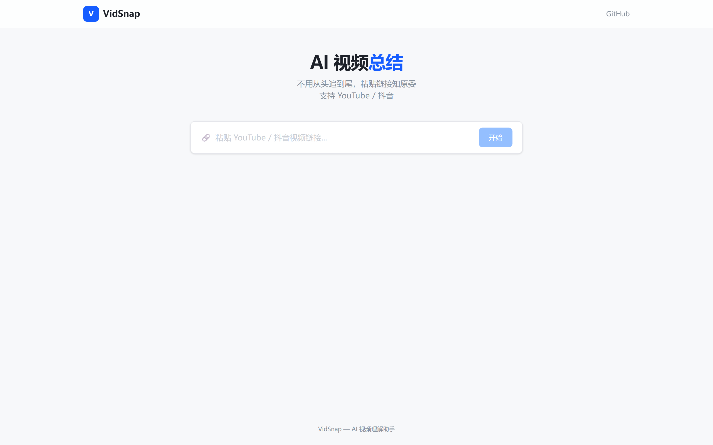
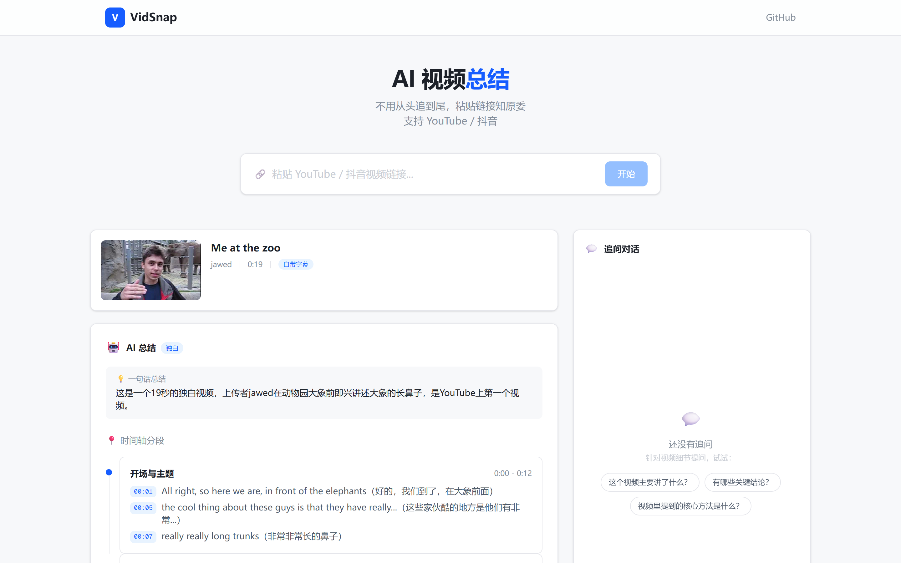
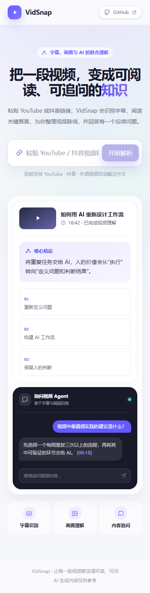
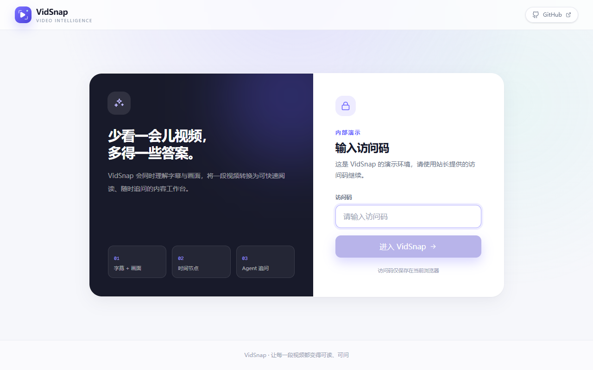

# VidSnap — AI 视频理解助手

> **一句话**：丢给它一个 YouTube / 抖音链接，AI 替你看完，然后你可以问任何问题。

独立从 0 到 1 构建的 AI 视频理解应用，打通「链接解析 → 音视频下载 → 三级降级转写 → 关键帧视觉理解 → LLM 结构化总结 → Agentic RAG 追问」全链路，支持 YouTube / 抖音双平台。

> **优化进展（2026-10-22）**：[完整优化方案](docs/OPTIMIZATION_PLAN.md) 已推进 M0 四批实现：接口、会话及资源隔离，缓存证据与帧索引，媒体出站边界，以及 [Whisper 单进程故障恢复](docs/WHISPER_RECOVERY.md)。本地转写增加握手、请求 ID、排队与总预算、退出恢复及串行脚本兜底；真实部署网络/推理冒烟仍待补，不能宣称 M0 整体验收通过。当前仍依赖个人电脑在线；云端转写时间戳为估算，主总结的 Claude 流式切换尚不完整。

## 演示

| 首页 | 视频理解工作台 | 移动端 |
|------|------|------|
|  |  |  |

访问码门禁（公开部署的安全设计）：



> 在线 Demo：<https://vidsnap.amorsum.top>（需访问码，本地运行 + Cloudflare 隧道，电脑在线时可用）

## 功能特性

| 功能 | 说明 |
|------|------|
| 现代响应式工作台 | 聚焦链接输入、处理进度、关键帧画廊、时间线总结与 Video Agent 的一体化布局，兼顾桌面端与移动端体验 |
| 一键视频总结 | 粘贴链接 → 自动下载 → 转写 → 输出结构化摘要（一句话总结 + 分段要点 + 时间戳） |
| 关键帧视觉理解（多模态） | FFmpeg 均匀采样抽帧 → Qwen3-VL 视觉模型逐帧描述 → 与字幕按时间戳融合进总结，关键帧画廊可点击跳转分段 |
| 追问对话（Agentic RAG） | 模型自主决策检索策略（语义/关键词/时间范围三工具 tool-calling），回答可溯源到秒级时间戳，前端可见工具调用轨迹 |
| 跨语言理解 | 英/日/韩等外语视频自动输出中文总结 |
| 双平台 | YouTube（yt-dlp + 字幕优先）+ 抖音（Playwright 解析 + ffmpeg 下载） |

## 系统架构


## AI 工程亮点

> 本项目的核心不是"能跑"，而是「把 LLM 从能跑做成可信、可控、可评估、可观测」。以下每一点都可以在面试中展开。

1. **三级降级转写**（成本/延迟/可用性权衡）：视频自带字幕 → 硅基流动 SenseVoice 云端 API → 本地 faster-whisper 常驻服务器。单 Node 进程共享串行转写队列，握手和请求 ID 隔离响应；排队、启动、推理与脚本兜底共用默认 10 分钟预算。保留既有短抖音 tiny 策略，本批没有质量或提速实测结论
2. **多模态关键帧视觉理解**：FFmpeg 均匀采样抽帧（确定性时间戳）→ 硅基流动 Qwen3-VL 批量画面描述 → 与字幕按时间戳融合进总结（画面与字幕冲突时以画面为准，±5s 容差语义对齐）；视觉链路任何失败静默降级音频-only；关键帧画廊 + HMAC 签名帧图服务 + 2h 生命周期管理
3. **Agentic 追问（tool-calling）**：检索策略从固定管线升级为模型自主决策——语义检索/关键词检索/时间范围三工具，DeepSeek function calling 与 Claude tool_use 双协议归一；轮数上限 + 重复调用终止 + 无工具终轮三重防死循环；前端可见工具调用轨迹
4. **向量 RAG**：字幕分段 bge-m3 向量化（4000 字符截断 + 32 条分批防超长 500），余弦相似度 top-k；回答可溯源到秒级时间戳
5. **结构化输出**：JSON mode（`response_format: json_object`）替代手写 JSON 补丁解析，删掉 60 行脆弱代码，保证 schema 可靠
6. **评测体系（Eval）**：LLM-as-judge 量化总结质量——要点级幻觉率 0.0%、参考要点召回率 99.1%（12 条评测集：教程/评测/新闻/访谈/演讲 × 中/英/日多语言，含 1 条真实 YouTube 视频）；评测脚本复用生产 prompt，零漂移，结果 JSON 归档可追溯
7. **成本可观测**：全链路 token 用量 + 成本埋点（区分缓存命中/未命中单价、视觉模型独立计价），单视频成本可量化到分——实测 **¥0.0064 / 1769 tokens / 25.7s**（不含视觉：视觉单次 902 tokens ≈ ¥0.0017）
8. **LLM Provider 抽象层**：DeepSeek（默认）/ Claude 一键切换（两套 API 格式归一），SSE 流式输出 + 15s 心跳解决 Cloudflare 隧道 100s 超时断连
9. **防幻觉设计**：每个要点强制绑定时间戳与原文依据，摘要结论可验证
10. **平台处理器模式**：统一 `getInfo/download` 接口，主流程零 if/else 分平台，扩展新平台只需注册一个处理器

## 质量与成本数据

### 总结质量评测（LLM-as-judge）

运行：`npx tsx scripts/eval/summarize-eval.ts`（`--only <id>` 跑子集；结果归档 `scripts/eval/results/`）

| 指标 | 结果 |
|------|------|
| 评测集规模 | 12 条（教程/评测/新闻/访谈/演讲 × 中/英/日，含 1 条真实 YouTube 视频） |
| 要点级幻觉率 | 0.0%（139 个要点，0 幻觉） |
| 参考要点召回率 | 99.1%（106 个参考要点覆盖 105 个） |

### 单视频实测成本（DeepSeek）

| 指标 | 数值 |
|------|------|
| 总耗时（含下载/转写/总结） | 25.7s |
| 缓存命中重复请求 | ~3s |
| LLM tokens | 1769 |
| LLM 成本 | ¥0.0064 |

## 安全

- **访问码门禁**：`ACCESS_CODE` 环境变量 + 前端门禁页（`/api/verify` 校验，暴力猜测有失败计数限流）
- **每 IP 滑动窗口限流**：`/api/process` 10 次/10 分钟，`/api/followup` 30 次/10 分钟，防刷爆 API Key
- **代理 IP 读取**：优先读取 `cf-connecting-ip`；只有源站入口受控且代理覆写头时才可信
- **会话隔离**：HttpOnly 匿名会话绑定分析 ID；结果、字幕、对话、帧图和删除均校验归属，写接口增加来源与 JSON 内容类型校验
- **媒体出站校验**：短链逐跳验证；yt-dlp、浏览器与直链下载限制平台/CDN 域名和公网 DNS，连接固定已验证 IP；FFmpeg 仅处理本地输入。应用边界不替代系统级出站策略
- **临时文件清理**：主处理使用独立分析目录；成功清媒体、异常/删除清本分析，帧有独立到期清理，不按平台 ID 前缀删除共享文件。进程崩溃后的扫尾仍依赖后续分析触发

## 测试

`npm run test:security` 覆盖接口保护、会话隔离、删除竞态、期限与独立产物目录，使用模拟媒体/模型和真实文件清理，不发生付费调用。历史完整流水线测试为 44 条用例 43 通过 / 1 环境相关，见 [历史报告](docs/test-reports/TEST-20260831.md)，不代替当前回归结果。

## AI 协作开发

本项目全程与 AI 结对开发（TRAE 起步 → Claude Code 多智能体工作流），并沉淀了一套可复用的多智能体协作体系（3 个专职 agent + 3 个 skill + 自动进度文档化），详见 [docs/AI_CODING.md](docs/AI_CODING.md)。

## 技术栈

- **前端**：Next.js 16 + React 19 + TypeScript + Tailwind CSS v4
- **视频处理**：yt-dlp（YouTube）、Playwright + ffmpeg（抖音，绕过 X-Bogus 签名）
- **ASR 转写**：硅基流动 SenseVoice API（云端）/ faster-whisper（本地降级，CUDA 加速）
- **视觉理解**：FFmpeg 关键帧抽取 + 硅基流动 Qwen3-VL-32B（OpenAI 兼容接口，批量多图描述）
- **AI 引擎**：DeepSeek API（默认）/ Claude API（可切换），SSE 流式输出，tool-calling 双协议归一
- **向量检索**：硅基流动 bge-m3 embedding + 余弦相似度检索
- **部署**：本地生产模式 + Cloudflare Tunnel（`vidsnap.amorsum.top`）

## 快速开始

```bash
# 安装依赖
npm install

# 配置环境变量（复制 .env.example 为 .env.local 并填入 Key）
# DEEPSEEK_API_KEY=sk-xxx       # 必填，LLM 总结
# SENSEVOICE_API_KEY=sk-xxx     # 可选，云端转写 + embedding + 关键帧视觉理解（一 key 三用）
# ACCESS_CODE=your-code         # 可选，访问码门禁
# VISION_ENABLED=0              # 可选，显式关闭视觉理解（默认有 key 即启用）

# 本地启动
npm run dev
```

外部依赖：yt-dlp（PATH 中）、FFmpeg、Python 3.12+（媒体网络边界及抖音解析需要；本地 Whisper 降级另需 `pip install faster-whisper`）。

媒体出站默认直连，不自动使用系统/环境代理或 yt-dlp 本地配置。需要代理时在 `.env.local` 配置 `MEDIA_UPSTREAM_PROXY=http://127.0.0.1:<HTTP或mixed端口>`，并保证 DNS 返回真实公网地址；迁移限制及完整规则见 [媒体网络说明](docs/MEDIA_NETWORK.md)。

本地转写可配置 `WHISPER_TIMEOUT_MS`（默认 600000）和 `WHISPER_STARTUP_TIMEOUT_MS`（默认 120000）；队列满/超时明确失败，不并行启动脚本绕过限制。配置、协议兼容和恢复边界见 [Whisper 恢复说明](docs/WHISPER_RECOVERY.md)。

## 开发与验证

使用 `demo` 作为日常开发分支，`main` 作为主分支。功能验证通过并经确认后再发布到主分支；提交和推送前先概述改动并获得确认，不自动同步两个分支。现有 `master` 保留历史 B 站实现，供后续查阅，本轮不合入、不删除，也不为常规优化额外创建分支。

```bash
npm run lint
npx tsc --noEmit
npm run test:security
npm run build
```

`test:security` 使用独立测试进程、限流桶、模拟媒体/模型响应和真实临时目录，覆盖接口保护、输入边界与历史接口文件清理，不需要真实密钥或付费调用。当前未提供 `npm test`。已有生产服务运行时，在独立项目副本执行构建，避免改写服务使用的 `.next`。

接口调用需要保存服务端签发的会话 Cookie；追问与删除应回传 `analysisId` 和 `videoId`。内容默认保留 1 小时，帧默认 2 小时，缓存命中不续期；详见 [匿名会话与分析资源](docs/API_SESSIONS.md)。

视频入口接受 YouTube 的 watch、youtu.be、shorts、embed、v 视频链接，以及抖音 `/video/<数字 ID>` 和 `v.douyin.com` 短链接；拒绝用户主页、异常端口、userinfo 和伪造域名。服务端移除分享参数后再处理。主处理及两个历史处理接口共用每 IP 10 次/10 分钟额度；追问与删除各为 30 次/10 分钟，429 返回 `Retry-After`。代理 IP 头仅在受控源站入口和代理覆写条件下可信。

两个历史接口 `/api/process/summarize`、`/api/process/transcribe` 保留现有 JSON 响应；仓库内未发现调用方，先做兼容保护，后续再明确停用策略。主接口仍使用原 SSE 协议。

## 部署（Cloudflare Tunnel）

`cloudflared.exe` 客户端**不随仓库分发**（二进制约 54MB），需自行下载：

1. 从 [Cloudflare 官方下载页](https://developers.cloudflare.com/cloudflare-one/connections/connect-networks/downloads/) 下载对应平台的 `cloudflared`，放至项目根目录
2. 复制 `cloudflared-config.example.yml` 为 `cloudflared-config.yml`，按注释填入隧道凭据
3. 运行 `start.bat` 一键启动（服务 + 隧道）；如需开机自启，配置 `autostart.bat`（Windows 启动文件夹 + VBS 静默运行）

## 目录结构

```
├── README.md                    # 项目简介
├── PRODUCT_PLAN.md              # 完整产品方案
├── docs/
│   ├── CONTEXT.md               # AI 助手项目上下文
│   ├── AI_CODING.md             # AI 协作开发工作流（多智能体体系）
│   ├── IMPROVEMENT_PLAN.md      # 改进方案与执行进展
│   ├── OPTIMIZATION_PLAN.md     # 分阶段优化方案与 M0 当前进展
│   ├── API_SESSIONS.md          # 匿名会话、分析归属和接口兼容说明
│   ├── screenshots/             # 演示截图
│   └── test-reports/            # 自动化测试报告
├── .claude/                     # Claude Code 多智能体工作流
│   ├── agents/                  # 3 个专职 agent（提交/规范/测试）
│   ├── skills/                  # 3 个可复用 skill（git-push 含文档同步）
│   └── hooks/                   # Stop 钩子 + 进度指纹
├── src/
│   ├── app/
│   │   ├── icon.svg             # 品牌图标与浏览器页签图标
│   │   ├── page.tsx             # 响应式首页与视频理解工作台
│   │   └── api/
│   │       ├── process/         # 视频处理管线（SSE 流式 + 视觉理解阶段）
│   │       ├── followup/        # Agentic 追问（tool-calling）
│   │       ├── frames/          # 关键帧图片服务（HMAC 签名鉴权）
│   │       └── verify/          # 访问码校验
│   ├── components/              # UI 组件（含 KeyframeGallery 关键帧画廊）
│   └── lib/
│       ├── llm.ts               # LLM Provider 抽象 + tool-calling 循环
│       ├── vision.ts            # Qwen3-VL 视觉理解 + 帧图签名
│       ├── keyframes.ts         # FFmpeg 抽帧 + 帧文件生命周期
│       ├── rag.ts               # 向量/关键词检索
│       ├── embeddings.ts        # bge-m3 embedding 封装
│       ├── observability.ts     # token 用量 + 成本核算（含视觉计价）
│       ├── security.ts          # 访问码 + 滑动窗口限流
│       ├── request-validation.ts# JSON、视频 ID 和问题的运行时校验
│       ├── media-workspace.ts   # 历史接口独立媒体目录与 finally 清理
│       ├── session.ts           # 服务端匿名会话 Cookie
│       ├── analysis-store.ts    # 分析归属、状态和有效期
│       ├── analysis-artifacts.ts# 独立产物目录、边界验证与到期清理
│       ├── platforms.ts         # 平台处理器注册
│       ├── transcriber.ts       # 转写调度（三级降级）
│       ├── whisper-client.ts    # 共享队列、握手、预算及故障恢复
│       ├── sensevoice.ts        # SenseVoice 云端 API
│       ├── video-processor.ts   # yt-dlp 视频处理
│       ├── douyin-processor.ts  # 抖音解析（Playwright）
│       ├── prompts.ts           # Prompt 模板
│       ├── process-cache.ts     # 结果缓存（1h 过期）
│       ├── transcript-store.ts  # 原文 + embedding 存储（追问用）
│       ├── conversation-store.ts# 多轮对话历史
│       └── url-utils.ts         # URL 解析与平台检测
├── tests/                       # 无付费依赖的安全与历史接口回归
└── scripts/
    ├── whisper_server.py        # Whisper 常驻服务器（消冷启动）
    ├── whisper_asr.py           # Whisper 降级脚本
    ├── whisper_audio.py         # 有界预处理与 WAV 清理
    ├── douyin_playwright.py     # 抖音 Playwright 解析
    └── eval/                    # 总结质量评测（LLM-as-judge，fixtures + results 归档）
```

## 路线图

- [x] 核心链路 + 双平台 + RAG 追问
- [x] 结构化输出 + 评测集 + 成本可观测
- [x] 鉴权限流 + 自动化测试体系（30/30）
- [x] 关键帧视觉理解（音视频多模态，Qwen3-VL + 关键帧画廊）
- [x] 追问 Agent 化（tool-calling 自主决策检索策略）
- [ ] 异步任务队列 + 持久化向量库
- [ ] 云端容器化部署（24/7 在线）
