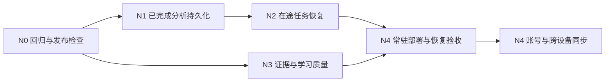

# VidSnap 下一阶段优化计划

日期：2026-10-29，进展更新至 2026-10-30。状态：第一阶段学习闭环和 N0 已完成；N1 保留隔离原型，N3 已开始，N2 和 N4 尚未实施。不以规划或存储原型宣称生产能力已具备。

N0 已完成：`fcb3987` 的 Windows GitHub Actions 完整通过，包括隔离浏览器检查；本机 25 组浏览器检查、故障清理演练与发布回滚清单已完成。N1 已开始：PostgreSQL 表结构和存储适配器原型已在隔离测试库验证，应用接入与重启恢复尚未完成，详见 [报告](test-reports/TEST-20261029-N0-N1.md)。

2026-10-30 按用户要求暂缓数据库配置，先做独立的 N3 质量改进；日语假名、韩文和数字关键词降级已用合成样本验证，真实视频和模型质量评测仍待实施。N2 可靠任务恢复仍依赖持久状态，不因调整顺序而视为完成。

## 1. 当前阶段的结论

| 第一阶段目标 | 当前状态与证据 |
| --- | --- |
| 三平台视频入口 | YouTube / Bilibili / 抖音处理器已接入；B 站 BV/av、短链与指定分 P 已支持，访问码已移除 |
| 单视频学习 | 总结、原文时间引用、追问、术语解释、复习题与按需参考答案已实现 |
| 知识保留 | 本地笔记、摘录、Markdown、JSON 备份/导入、冲突副本与失败回滚已实现 |
| 持续学习与找回 | 章节学习标记、手动复习记录、状态筛选、本地全文搜索与来源定位已实现 |
| 验证范围 | 最近交付有 316 项自动回归、25 组替身浏览器检查和本机/公网交互验收；见 [全文搜索报告](test-reports/TEST-20261029-NOTEBOOK-SEARCH.md) |

当前阶段的功能目标已完成。真实转写准确率、复习题教学质量、完整视觉覆盖和所有平台持续可用性仍需补充评测。约 41 分钟 B 站真实文字链路成功属于单样本工程证据，不能代表这些质量指标。

本轮不新增学习页面控件；数据库原型只使用隔离测试环境，线上服务仍使用内存存储。

## 2. 代码核对发现

| 事实 | 代码依据 | 用户影响 |
| --- | --- | --- |
| 匿名会话注册表仅在进程内 | [session.ts](../src/lib/session.ts) 的全局 Map，当前会话期限 24 小时 | 仅保存结果不足以实现重启恢复，原 Cookie 也会失去服务器身份映射 |
| 分析归属、结果、字幕和对话均在内存 | [analysis-store.ts](../src/lib/analysis-store.ts)、[process-cache.ts](../src/lib/process-cache.ts)、[transcript-store.ts](../src/lib/transcript-store.ts)、[conversation-store.ts](../src/lib/conversation-store.ts) | 重启后无法校验归属或继续追问；本地笔记不受影响 |
| 恢复连接只查同进程执行或缓存 | [process-flights.ts](../src/lib/process-flights.ts)、[主路由](../src/app/api/process/route.ts) 的 resumeOnly | 浏览器刷新恢复已实现，服务器重启后的任务恢复尚未实现 |
| 帧签名密钥按进程生成 | [vision.ts](../src/lib/vision.ts) 的随机签名密钥 | 帧文件还在也不能直接保证旧签名在重启后可用 |
| 自动回归和基础 CI 已具备 | [package.json](../package.json) 提供 test:security，`fcb3987` 的 GitHub Actions 完整通过 | 隔离浏览器检查已纳入 CI，真实模型质量仍需单独评测 |
| 部署依赖个人电脑 | [部署脚本](../scripts/start-services.ps1) 与现有隧道方式 | 电脑睡眠、关机或网络变化会影响公网服务 |
| 云端时间为估算，检索降级主要覆盖中文/英文 | [sensevoice.ts](../src/lib/sensevoice.ts)、[rag.ts](../src/lib/rag.ts) | 外语、数字、人名、否定词和精确引用需独立质量评测 |

以上为本轮静态核对，不代表本轮重新执行了媒体、模型或故障测试。

## 3. 优先顺序

| 批次 | 优先级与目标 | 范围 | 完成标准 |
| --- | --- | --- | --- |
| N0 回归与发布检查 | 已完成 | 可重复无付费检查、隔离浏览器入口、CI、发布与回滚清单 | CI 和本机隔离检查通过；故障清理演练不改动生产构建 |
| N1 已完成分析持久化 | P0，解决每次重启丢追问 | 会话映射、归属、已完成结果、完整证据、对话、TTL、删除状态及帧元数据 | 同一 Cookie 在原期限内重启后可读原结果并追问；恢复不重复下载/ASR/总结；过期和删除不复活，越权仍拒绝 |
| N2 在途任务恢复 | P1，长任务脱离 Web 生命周期 | 持久任务、Worker、租约、事件游标、取消、有限重试与容量控制 | Web 重启不断任务；Worker 终止后按租约接管；旧执行不能回写；恢复不重复建单或拼接 token |
| N3 证据与学习质量 | P1，可从 N0 并行准备 | 真实字幕/音频样本、引用、长视频章节、复习题与参考答案、日韩检索 | 冻结样本与人工参考，逐样本报告事实/引用错误、覆盖、时间误差、延迟与已知费用；改进前后可比较 |
| N4 稳定部署与身份同步 | 先部署，再接身份与跨设备数据 | 常驻环境预检、健康/回滚/备份、预算；随后账号与笔记同步 | 目标环境通过三平台出站检查与恢复演练；账号上线后数据隔离、同步冲突、删除和额度原子扣减通过 |

N4 的账号和同步需复用 N1 的身份与数据边界；具体登录方式、运行环境和费用配置在实施时确定，不把旧产品方案的候选服务当作既定选型。支付、插件、更多视频平台和跨视频模型知识库继续保留为后续需求。

## 4. 下一轮 N0 的具体交付

1. 核对现有测试的 Node、Python、FFmpeg/FFprobe 和路径依赖，以当前 Windows 链路建立首个干净环境基线，再评估 Linux；不在每次提交下载模型或调用真实 API。
2. 将隔离副本准备、显式替身配置、端口就绪、浏览器执行和进程退出整理为仓库内脚本，摆脱忽略目录里的临时手工命令。限定临时目录和进程归属，失败也清理自己创建的资源。
3. 默认执行现有 lint、类型、自动回归和构建；浏览器阶段使用当前 backup / progress / search 流程。早期依赖访问码的旧浏览器入口先标记兼容范围，不宣称全部历史脚本可直接运行。
4. 增加 CI 配置，普通检查不需要项目真实密钥、Cookie 或隧道；将真实视频/模型验收分离为显式预算下的手动步骤。CI 只做检查，不自动连接或重启个人电脑上的生产服务。
5. 固化发布记录：提交版本、检查范围、旧构建位置、依赖预检、就绪验证和回滚操作；验证构建失败时保留旧服务或可靠恢复。本地学习数据保留，内存态阶段的在线分析失效要明确告知。

验收产物：可重复命令、CI 配置、隔离浏览器日志、故意失败一次后的退出/清理记录、发布检查清单。这里只列计划，不提前写“CI 已通过”。

## 5. N1 的边界与验收用例

数据目标沿用 [完整优化方案](OPTIMIZATION_PLAN.md) 的 PostgreSQL 方向；先在独立测试库做存储契约和迁移验证，当前生产继续使用既有内存模式。具体依赖、连接配置和版本在实施时核对，不先采购云资源或静默启用新后端。

- 会话凭据与 ownerId 分离，服务端保存凭据摘要及原期限，不在数据库日志中保存原始 Cookie。浏览器导入的笔记不能当作服务器身份、证据或在线追问资格。
- 已完成结果与完整证据版本一致提交，成功后再公布完成状态。可选向量缺失时保留关键词/时间检索；对话仍按既有窗口和字幕期限处理。
- 保持会话 24 小时、正文/缓存 1 小时、帧 2 小时的现有期限；从原绝对到期时间判断，重启、缓存读取和追问均不续期。
- 帧访问保持归属与签名验证。需要跨重启访问时单独处理持久签名密钥、到期和轮换，不复用模型 Key、不保存旧的带签名 URL 冒充可恢复产物。
- DELETE 先使记录与所有读取路径失效，再清理精确产物。与在途结果提交使用状态/版本条件防止回写复活，保留失败清理的后续重试记录。
- 存储不可用时返回可区分的服务错误，不将“无法查询”误报成“数据已过期”，也不回退到未校验归属的内存副本。

| 隔离测试 | 预期 |
| --- | --- |
| 完成分析、重启 Web、用原 Cookie 查询/追问 | 原期限内恢复归属、正文和对话；复用原证据，恢复本身不再调用上游 |
| 另一个会话访问同一 analysisId | 不泄漏他人记录，仍返回不可用 |
| 假造 Cookie 或上传含原 analysisId 的本地备份 | 无法获得在线追问资格 |
| 到期前后跨进程读取 | 原到期时间不变，过期记录不可恢复 |
| 删除后重启、删除与提交竞争 | 结果/证据/对话/帧引用均不复活，不影响其他分析 |
| 数据库断连或写入中断 | 不发布半份成功结果，不误判为过期，不暴露正文或凭据 |
| 帧文件缺失、签名过期或密钥不兼容 | 有明确降级或拒绝，不绕过签名与归属校验 |
| 在途分析遇到进程退出 | N1 只明确标记中断，不自动重跑；可靠接管属于 N2 |

## 6. N3 如何避免“流程成功就是质量通过”

2026-10-30 已增加 [离线时间引用检查](CITATION_AUDIT.md)，支持分析结果和笔记备份，覆盖格式、越界和证据空档。此工具只检查时间位置，事实依据与真实对齐仍未评测；下一项可用固定真实样本开展逐要点人工核查，并记录否定词、数字和复习题问题。

先准备少量短样本，区分内置字幕、云端识别和本地降级；以中文/B 站当前主路径优先，逐步加入外语、噪声、人名、数字和无语音样本。复用已下载或已分析样本，控制真实调用次数。保留失败样本，不通过删掉困难样本达标。

质量表分别记录：转写错误、引用是否能找到证据、真实/估算时间、章节遗漏、无依据回答、复习题是否可由视频回答、参考答案是否透露额外事实。评审样本、提示词、模型配置、耗时与已知成本均有版本；缺少费用数据记未知。模型评分用于辅助，保留人工核对。

当前不承诺统一秒级引用精度、固定长视频耗时或总体质量提升比例；在固定样本基线后再确定改进门槛。

## 7. 交付与现有约束

保持三个平台、字幕→云端→本地降级、可选视觉/向量降级、SSE 事件及结果字段、追问三工具与调用预算、匿名资源归属和精确删除。新增 API/数据库迁移只兼容扩展，逐批验证。

每批只公布实际完成和执行过的检查。规划、替身浏览器、真实媒体、真实模型和公网入口分别记录；纯文档变更检查链接及 diff，不为规划重启生产、跑付费模型或声称新测试已通过。

N0—N4 的完成标记由实施记录更新。账号、生产数据库接入、Worker 和新运行环境尚未交付。
