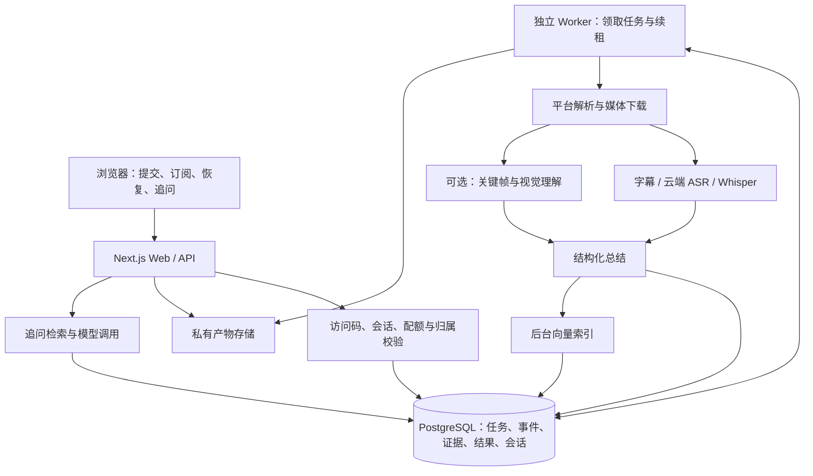

# VidSnap 完整优化方案

> 日期：2026-10-21。状态：M0 第一批安全入口修复已实施并验证；M0 整体与 M1—M4 未完成。具体进度见第 17 节。
>
> 依据：当前本地源码、README、项目上下文、历史改进计划，以及本轮代码审查。目标是改善分析速度、多语言准确性和运行稳定性，同时补齐数据隔离与可重复验证能力。
>
> 阅读方式：第 1—3 节说明目标与架构，第 4—11 节给出实现设计，第 12—15 节定义实施顺序、验收、迁移和待确认事项。文中的性能数字均为建议目标，不是本轮实测结果。

## 1. 范围与基本决策

本轮优化围绕现有 YouTube / 抖音分析和追问展开。保留 Next.js、React、TypeScript、现有平台处理器、三级转写降级、SSE 和追问三工具契约。

推荐决策：

| 领域 | 推荐方案 | 原因与边界 |
| --- | --- | --- |
| 应用架构 | Next.js Web/API + 独立 Node.js Worker | HTTP 连接与媒体长任务分离，复用现有 TypeScript 模块 |
| 持久化 | PostgreSQL 保存任务、结果、字幕、会话与产物元数据 | Web、Worker 和重启后的进程读取同一份状态 |
| 首期队列 | PostgreSQL 任务表、短事务领取、租约与重试 | 当前规模先减少运维组件；后续按实测吞吐决定是否引入 Redis/BullMQ |
| 向量检索 | 先保留现有检索算法并持久化向量；需要时增加 pgvector | 先解决丢数据和分段质量，再用数据量与延迟决定索引方案 |
| 帧图存储 | 单云主机先用共享持久卷，多主机再切私有对象存储 | 保留产物目录隔离、签名访问与生命周期管理 |
| 转写 | 字幕优先 → 云端 ASR → 本地 Whisper，增加质量复核 | 保留现有降级，同时处理“请求成功但识别错误” |
| 部署 | 首个版本采用云主机上的容器组合，按资源隔离 Web 与 Worker | 能运行 Python、浏览器和媒体工具，适合现有长任务 |
| 用户隔离 | 访问码保留，先增加服务端匿名会话及资源归属 | 先解决串话、越权和误删，再按产品需要引入账号体系 |

暂缓 B 站、支付、跨视频知识库、浏览器插件等功能。它们不作为本轮验收条件。

## 2. 当前问题与优先级

以下是代码层面发现；生产故障频率、耗时占比和外语错误率尚需建立基线。

| 编号 | 优先级 | 发现 | 主要位置 | 处理方向 |
| --- | --- | --- | --- | --- |
| S1 | P0 | 两个历史处理接口缺少主接口的访问码与限流 | `src/app/api/process/{summarize,transcribe}/route.ts` | 先统一保护，再核对调用并决定兼容或停用 |
| S2 | P0 | 对话只按 videoId 保存，不同会话可能共用历史 | `src/lib/conversation-store.ts` | 会话、分析记录、对话分别建模 |
| S3 | P0 | DELETE 缺少严格类型/归属校验，临时文件按 ID 前缀删除 | `process/route.ts`、`video-processor.ts` | 精确产物清单、任务目录和授权校验 |
| S4 | P0 | URL 匹配没有严格校验协议与主机名 | `src/lib/url-utils.ts` | 规范化 URL，校验入口和重定向目标 |
| P1 | P1 | 转写、视觉、总结与向量生成串行，向量生成延后正式结果 | `process/route.ts` | 分阶段计时、受控并行、后台索引 |
| P2 | P1 | 缓存查询前仍进行平台解析，缺少同视频在途请求合并 | `process/route.ts`、`platforms.ts` | 规范键、元信息缓存、幂等与任务复用 |
| Q1 | P1 | 云端成功结果缺少质量复核，短抖音本地降级按时长选择 tiny | `transcriber.ts`、`process/route.ts` | 语言提示、质量信号、困难片段重试 |
| Q2 | P1 | SenseVoice 时间戳按字数估算，来源统一写成 whisper | `sensevoice.ts` | 来源与时间精度元数据、真实对齐 |
| Q3 | P1 | 缓存命中覆盖追问库时只恢复字幕，丢失画面段落 | `process/route.ts` | 缓存与检索库共享完整证据版本 |
| Q4 | P1 | 部分视觉批次失败、备用模型补齐后，图片按结果序号绑定 | `vision.ts`、`process/route.ts` | 传递稳定 frameId，准确关联原始文件 |
| R1 | P1 | Whisper 在途请求缺少超时及进程退出时的拒绝/队列恢复 | `transcriber.ts` | 请求 ID、就绪握手、超时和故障恢复 |
| R2 | P1 | 浏览器断开只关闭 SSE，未建立持久任务和恢复订阅 | `process/route.ts`、`page.tsx` | 任务 ID、事件序号、重连与明确取消 |
| R3 | P1 | 字幕、结果、对话为进程内 Map；对话缺少 TTL | 三个 store/cache 模块 | 持久化、容量预算、过期清理 |
| Q5 | P1 | 关键词检索忽略韩文与假名，跨语言降级能力不足 | `rag.ts` | Unicode 分词/字符 n-gram、跨语言查询策略 |
| E1 | P2 | JSON mode 后只做 JSON.parse，缺少运行时结构和引用校验 | `process/route.ts` | 统一 schema、约束与有限修复 |
| E2 | P2 | 主总结流式函数只支持 DeepSeek，Claude 切换不完整 | `llm.ts` | Provider 能力声明与协议一致性测试 |
| E3 | P2 | 成本按固定模型价格计算，缺少 ASR/embedding 等成本范围说明 | `observability.ts` | 记录实际 provider/model、价格版本与未知项 |
| E4 | P2 | 历史报告不能自动回归；现有 Eval 仅评字幕到总结 | `scripts/eval/`、测试报告 | 自动测试、音频评测、故障演练与 CI |

P0 先修复，再开放更大访问范围；P1 为本轮体验与可靠性主线；P2 与主线按依赖穿插进行。

## 3. 目标架构与模块边界



快速模式只等待文字证据与总结。完整模式在视觉总预算内融合画面，预算耗尽后使用已成功描述的帧并明确显示能力降级。向量准备状态与总结可读状态分开管理。

推荐按阶段提取以下职责，不一次性重写所有文件：

```text
src/
  app/api/                 # HTTP、鉴权入口、SSE 适配
  lib/jobs/                # 任务状态、领取、租约、事件、取消、重试
  lib/pipeline/            # 主流程编排与各阶段执行
  lib/asr/                 # 统一转写类型、语言与质量策略、provider 适配
  lib/storage/             # 数据访问、产物清单、TTL 与删除
  lib/contracts/           # 请求、结果、事件的运行时 schema 和共享类型
  lib/                     # 保留并逐步接入现有平台、LLM、RAG 等模块
scripts/
  worker.ts                # 独立 Worker 入口
  whisper_server.py        # 保留常驻转写
  whisper_asr.py           # 保留脚本兜底
tests/                     # 无付费依赖的自动回归与接口集成测试
```

## 4. 安全、会话与文件生命周期

### 4.1 统一接口保护

- 主处理、历史处理、追问、任务查询、取消、删除及帧图均执行对应的鉴权和归属规则。
- 历史接口先补保护、错误与清理，再查找调用方；无调用也需明确停用策略，避免部署中突然破坏外部使用者。
- 服务端生成匿名会话，以 HttpOnly、Secure、SameSite cookie 保存；访问码仍用于门禁。写操作校验来源，并根据部署方式加入 CSRF 防护。
- 共享访问码不能当成用户身份。会话绑定任务、对话和用户可见结果，客户端传入的 sessionId 不作为授权依据。
- 数据库持久化配额或原子计数，保留接口/IP 限流；全局并发、会话每日预算、排队上限共同控制消耗。
- 仅在受控代理入口信任转发 IP，应用源站限制直接访问。429 返回现有提示及 Retry-After。

### 4.2 输入与网络边界

- 对 JSON 做运行时类型、长度、枚举和数值边界校验，拒绝数组/对象充当字符串 ID。
- 用 URL 解析器验证 http/https、允许的主机名与视频 ID；拒绝 userinfo、异常端口和不支持路径。
- 短链接逐跳限制重定向次数、目标域名和地址范围。下载器/浏览器的出站访问同时限制环回、私网、链路本地和云元数据地址，避免只校验首次入口。
- 外部命令继续使用参数数组，防止用户输入变成 shell 参数或选项；下载大小、时长、磁盘空间和媒体进程数均有上限。

### 4.3 产物与删除

- 媒体放入 `taskId/attemptId` 独立工作目录，记录产物类型、准确路径、所有者和有效期。平台 videoId 不直接决定待删除文件集合。
- 删除校验最终路径处于产物根目录；拒绝路径穿越、非白名单 ID 及符号链接逃逸。禁止前缀扫描扩大范围。
- 删除任务先撤销在途执行权，阻止旧 Worker 提交结果，再删除文件、缓存、字幕、向量、对话及事件中的内容数据。
- 首期只在同一会话内合并任务，避免跨会话共享带来的删除语义与私有视频泄漏。若以后共享公开产物，必须先实现访问授权及引用计数。
- 保留媒体成功/失败清理、本地 Whisper 脚本兜底和无语音提示；Python 转换产物用 finally 清理，检查 FFmpeg 返回码。

### 4.4 保留期限

沿用结果缓存/字幕 1 小时、帧图/签名 2 小时作为默认内容期限。持久化用于重启恢复，不自动延长内容保存时间。

有效缓存必须引用尚未过期的帧；必要时返回重新签发且不超过文件有效期的签名。若帧不可用，明确移除或重建引用。对话与所属内容共同到期。后台定时清理与启动扫尾覆盖进程崩溃，不依赖内存定时器。

任务排障仅保留不含字幕、问答、媒体 URL、凭据的最小状态元数据；其保存期单独配置。长久历史记录属于后续显式产品决策。

## 5. 性能优化

### 5.1 先建立可比较的基线

每次记录 jobId、attemptId、平台、时长、语言、模式、缓存状态，以及解析、排队、下载、转写、视觉、总结、索引、总耗时。增加首个可读总结时间、ASR 实时率、下载体积、模型请求与重试次数。

缓存/非缓存、不同平台、不同长度、不同语言分别统计 p50/p95；冷启动与热启动分开。真实平台请求记录日期和失败阶段，不能将历史单视频成绩作为当前平均水平。

### 5.2 缓存与重复任务

- 可直接提取 ID 的规范链接先查询已授权的结果缓存，不必先跑 yt-dlp/浏览器。短链接首次解析后保存带 TTL 的映射。
- 将元信息、转写、帧描述、总结、向量分层缓存，使用平台、视频 ID、可见性范围、模式、转写/模型配置、Prompt/管线版本组成缓存键。
- 同一幂等键只建立一个有效任务；重复提交返回已有任务或结果。任务终态与重试更新使用事务和唯一约束。
- 缓存完整证据，包括字幕和画面；复用同一份证据恢复追问，不使用仅含字幕的简化版本覆盖它。
- 所有缓存设容量与字节预算。配置变化使相关层失效，防止更换语言/模型仍拿到旧结果。

### 5.3 减少关键路径等待

- 字幕/转写与低清视频下载、抽帧采用受控并行；限制下载、浏览器、FFmpeg、GPU 和模型请求各自的并发，避免 CPU/磁盘争抢抵消收益。
- 优先识别原始人工字幕，随后原始自动字幕；区分翻译轨道。只下载选定轨道，不一次下载所有语言。清理滚动重复字幕并保存语言、轨道来源。
- 字幕下载成功仍需解析和内容校验；格式损坏或结果为空时继续音频转写，不能直接归类为无语音。音频路径读取下载器实际输出，不假定所有后备格式都是 m4a。
- 总结成功且基础检索证据已存储后立即发布 result；向量生成在可靠后台任务中完成。准备期间关键词/时间检索可用，后台失败不会撤销总结。
- 云端 ASR、embedding、总结流均设置超时、取消和有上限重试。每阶段局部超时不能代替整条任务总预算。
- 无向量不阻断总结，不把可选 Key 变成全应用必填配置。

### 5.4 视觉与本地推理

- 提供快速/完整模式，默认模式在速度与质量基线之后确定；UI 在提交前解释两种输出范围。
- 完整模式初始视觉预算建议为 30 秒，按实际首轮结果调整。每批、每个备用模型共享剩余预算；预算耗尽停止新增请求，保留部分成功结果并显示降级原因。
- 每帧携带 frameId、源文件和实际提取时间；描述、排序、备用模型补齐都不能改变图片身份。后续再比较均匀采样与场景变化采样的质量/成本。
- 本地 Whisper 比较现有方案与 batched inference，在代表性日韩音频上同时测错误率、实时率和显存。只在结果满足质量门槛时调整解码参数。
- 当前开启 word_timestamps 但结果只保留片段时间；评估关闭这项未使用计算的收益，同时确认不影响所选对齐方案。
- 修复预加载 small、请求默认 medium 等默认值漂移，统一配置和模型版本；按显存预算限制常驻模型数量。

## 6. 多语言转写与时间引用

### 6.1 统一证据格式

转写结果新增 provider、model、language、languageSource、timestampKind、质量警告与原始文本版本；片段有稳定 segmentId。timestampKind 区分原生字幕时间、模型分段时间、额外对齐时间和估算时间。

旧 transcriptSource 字段兼容期保留，新增字段供前端准确展示。模型概率、启发式分数和真实人工错误率分开表达；上游未提供置信度时不伪造。

### 6.2 识别与重新转写策略

1. 先选择可用原语字幕，保留原文，翻译独立保存。
2. 无可用字幕时使用视频元信息及音频采样作为语言提示；允许用户指定自动/中文/英语/日语/韩语，提示不等于正确答案。
3. 保留云端优先、本地兜底。接口成功后检查空文本、重复循环、异常语言、语音区间覆盖、显著不合理的字符/时长关系等信号。
4. 对疑似低质量区间追加前后重叠音频进行一次复核。比较不同结果与可用质量信号；无法可靠选择时展示警告，允许用户重试/纠正。
5. tiny 不再仅由短时长自动选中。是否保留某语言的快速模型，由分语言评测决定；高质量模型作为候选而非未经验证的默认。

混语视频按连续语音区间处理并保留时间偏移，避免对每几秒音频独立检测造成抖动。合并时去除重叠重复文本，保留无法识别段落的缺失标记。重新转写设总次数和成本上限。

### 6.3 时间戳与内容可信度

- 优先使用带片段时间戳的识别输出。只有文本的输出采用经过语言验证的对齐方式补时间，记录对齐来源与误差。
- 对齐尚未完成或不可靠时明确标注“估算时间”，不提供精确时间承诺；按时间检索返回精度限制。
- 不通过总时长按比例拉伸文本制造精确时间。片段必须满足非负、start < end、合理时长范围，字幕与画面各自标记来源。
- 摘要可以翻译与整理，但不能把低置信度谐音强制恢复成确定的外语原句；修订与原文分别保存。
- 画面与字幕冲突时标明来源和不确定性，不无条件认定视觉描述更可靠。
- 多人内容未接入说话人分离前，不宣称人物身份或可靠说话人标注。

## 7. 任务、事件与持久化

### 7.1 状态与数据

建议任务状态：queued → running → completed / completed_with_warnings / failed / canceled；阶段另存 resolving/downloading/transcribing/vision/summarizing/indexing。resultReady 与 indexingStatus 为独立字段，避免“总结已可读”被解释为“全部后台工作结束”。

| 数据实体 | 主要字段/用途 |
| --- | --- |
| sessions | 服务端会话身份、有效期与预算 |
| jobs | 所有者、幂等键、模式、配置版本、状态、阶段、取消标记、租约、重试时间与次数 |
| job_events | jobId、递增序号、类型、时间和脱敏 payload，用于订阅恢复 |
| results / evidence_versions | 结构化结果、完整字幕/画面证据版本与有效期 |
| segments | 文本、时间、语言、来源、时间精度、segmentId 与可选向量 |
| conversations / turns | sessionId、analysisId、conversationId 和每轮消息 |
| artifacts | 精确路径/对象键、文件类型、frameId、有效期与归属 |
| usage_records | provider/model、阶段、usage、价格版本及计费范围 |

数据库首次启动执行版本化迁移；应用配置不兼容时提前报错。关键写入用事务，结果与证据版本一致后才发布 ready 事件。

### 7.2 队列语义

- Worker 在短事务中通过行锁领取到期任务并写入租约，处理期间不持有长数据库事务。
- 定期续租，过期租约允许其他 Worker 接管。每次领取递增 attempt/fencing 版本，旧 Worker 无权覆盖新尝试结果。
- 遵循至少一次处理设计，结果写入和产物提交幂等。外部模型请求不能保证恰好一次计费；不确定是否已成功的请求记录并限制重试。
- 网络/429/部分 5xx 按指数退避与 Retry-After 有限重试；参数、权限、视频删除、无语音等错误不盲目重复。
- 保存可复用的阶段产物，但恢复前校验版本、文件和 TTL；过期媒体重新下载，不延长默认保留期限。
- 队列满、Worker 离线或预算不足时明确拒绝或排队，不无限接收。首次并发从每 Worker 一个媒体任务起步，再依据资源监测调整。

### 7.3 API 与 SSE 兼容

新接口建议：POST `/api/jobs` 创建任务，GET `/api/jobs/:id` 返回快照，GET `/api/jobs/:id/events` 订阅，POST `/api/jobs/:id/cancel` 取消，DELETE `/api/jobs/:id` 清理所属资源。

迁移期 `/api/process` 保留现有 POST + SSE，内部调用同一任务服务并订阅事件。保留 progress、heartbeat、stream_start、stream、stream_end、result、error 的现有语义和字段；结果保留 transcriptSegments、frames、metrics，追问保留 answer、retrievalSource、toolsUsed。

新增 jobId、事件 ID、ready/indexing/warnings 字段采用兼容方式并同步前端。GET 订阅支持 Last-Event-ID 或游标；事件过期时返回快照，避免重复拼接旧 token。任务失败、流中断和连接关闭必须区分。

浏览器关闭仅停止订阅，任务可继续；用户点击取消才触发任务取消。取消向下载器、Python、模型请求传播，并在安全边界清理资源。同会话复用同任务时取消影响所有该任务观察者，界面需明确说明；跨会话不共用可取消任务。

## 8. RAG、总结与模型适配

- 字幕先去重并按语义/时间窗口合并，保留原片段映射与适度重叠，再生成向量；避免极短字幕缺乏语义。
- 关键词采用 Unicode 感知的字符 n-gram/分词，覆盖假名和韩文。中文问题对外语原文检索时，可在有限预算内扩展为原语查询；无向量的跨语言能力必须单独评测。
- 检索采用语义、关键词与时间条件结合，补相邻片段，比较 top-k、阈值和重排是否带来收益；不预先引入额外重排模型。
- 保留 semantic_search、keyword_search、segment_range 参数契约，轮数、重复签名、调用总量与超时守卫。为整个追问设置总预算，工具执行的 embedding 也受预算约束。
- 视频事实回答必须取得当前视频证据。检索无结果时明确缺少视频依据；补充常识要区分来源，避免把常识当成视频结论。
- 总结 schema 校验 overall、segments、points、类型、长度、时间顺序和范围；验证引用属于当前证据。格式错误可有限修复，内容证据不足不靠“修复”补造。
- 长视频按内容窗口生成带证据 ID 的局部摘要，再合并；设输入 token、输出长度与成本预算，测章节遗漏和跨段指代。分层摘要仅用于长输入。
- Provider 适配统一普通输出、流式输出、工具调用、usage 与错误；不支持某能力时在配置检查阶段明确反馈，补齐 Claude 主总结路径及能力测试。
- 模型输出和字幕一律视为不可信数据，不执行其中指令；工具仍只允许预定义检索能力。前端不能直接渲染模型工具语法。

## 9. 部署与稳定性

### 9.1 过渡期：本机继续运行

- 将应用与 cloudflared 交给具有故障恢复能力的服务托管，分别配置健康检查、重启退避和日志轮转。
- 检查失败时区分隧道、Next.js、Worker、数据库、媒体工具、模型和平台来源；心跳仅保持/观测连接，不保证任务恢复。
- 就绪检查必须验证所需进程与依赖，不能把任意 HTTP 响应当作就绪。启动等待超时后返回失败。
- 将 scripts 路径、Python 可执行文件、浏览器、cookies 位置改为配置；敏感值不进命令输出或测试报告。
- 本机仅作为过渡。服务托管不能消除电脑断电、睡眠、家庭网络和本机维护造成的停机。

### 9.2 推荐首个云端版本

一台经平台访问验证的云主机上运行 HTTPS 入口、Web、Worker、PostgreSQL 和私有持久卷；通过容器 CPU/内存限制，防止媒体处理挤占 Web。云端默认使用现有云端 ASR，保留可连接的本地 Whisper 能力。

先用短视频验证目标区域的 YouTube/抖音解析、登录态、下载、ASR 和视觉请求。按结果选择单区域；只有确实无法兼顾时，才增加平台专用 Worker。服务器大小按并发、浏览器峰值和媒体处理测量决定，不依据仅 Web 的常驻内存估算。

云端需要 Whisper 降级时，优先使用已部署且可用的推理 Worker；若只有个人电脑 GPU Worker，它离线时网页仍能访问、任务状态仍可恢复，但相关降级任务不能承诺完成。通过有上限等待、其他可用后端或明确失败处理，避免无限排队。GPU Worker 可主动连接受鉴权任务接口，数据库不暴露公网。

跨机器 Worker 不能直接使用另一台机器的本地音频路径：领取任务后通过短期授权的私有产物接口取音频，校验长度与摘要，在独立目录处理后回传结构化结果。权限绑定 jobId、attemptId 和 Worker 身份，取消或租约撤销后拒绝回写；传输失败进入同一重试预算，不把媒体地址公开到事件中。

抖音 cookies 改为受限凭据文件或秘密存储挂载，避免从个人浏览器数据库自动读取。检查有效性，过期时停止无效重试并提示运维更新。Python 锁定依赖、浏览器安装与版本，Linux/Windows 各自验证所需 CUDA 依赖；保留无 GPU 的降级行为。

### 9.3 发布、恢复与监控

- 使用独立构建目录或不可变镜像；禁止在生产服务共享的 `.next` 上直接构建。新版本通过就绪验证再切换，保留上个版本。
- 数据库迁移遵循先新增、再切读写、最后清理的兼容顺序；Worker 领取时校验可处理的管线版本。
- Worker 停止领取后等待当前任务或撤销租约，再关闭；新进程恢复有效任务。发布失败可回滚应用，不能依赖破坏性逆向迁移。
- 首期备份任务状态、schema 等必要元数据，排除字幕、问答、模型正文和短期媒体；结果正文的数据库持久化用于服务重启恢复，不承诺灾难后的正文恢复。恢复时先应用过期规则和删除记录，再开放访问。若以后需要正文备份，先单独定义保留和删除机制。首期单主机仍有单点风险，后续依据使用规模增加独立数据库/多 Worker。
- 区分存活、就绪和可选能力健康；外部模型异常不直接触发应用重启风暴。记录队列年龄、失败率、处理时长、内存/磁盘与凭据健康。
- 建议稳定运行目标为月可用性 99.5%；短期先完成连续 7 天观测，该结果不能外推为已达到月度 SLA。

## 10. 用户体验

- 提交时可选分析模式和语言提示，显示预计范围与队列状态；没有基线前不展示精确剩余秒数。
- 原有阶段百分比调整为单调进度或阶段状态，避免下载完成显示全局 100% 后回退。未知耗时用活动状态。
- 逐步展示可读摘要，保留 JSON 作为传输格式；半截 JSON 不直接展示给用户。
- resultReady 后允许关键词/时间追问，显示“语义检索准备中”；索引失败展示降级但不影响已生成内容。
- 支持刷新恢复、断网重连、明确取消、失败阶段提示和有意义的重试；静默 EOF 不当成完成。
- 展示实际转写来源、语言、时间精度、视觉覆盖/缺失，以及无法可靠识别的片段。
- 分段引用打开原视频对应时间；不支持的平台提供可理解的替代入口。导出 Markdown/字幕可在证据与权限完成后增量加入。
- 会话列表默认只显示仍在保留期的任务；到期删除与正文留存的说明保持一致。验证桌面、移动端和键盘操作。

## 11. 可观测性、成本与可重复验证

### 11.1 日志和成本

结构化日志包含任务/阶段/尝试、错误分类、耗时和实际模型；默认不包含访问码、cookies、完整用户字幕与问答、带签名 URL 或完整上游错误响应。用户错误消息与运维诊断分开。

成本记录总结、视觉、ASR、embedding、重试各自范围，包含 provider、实际 model、usage 来源、币种和价格生效日期。没有 usage/价格记 unknown，不填 0。备用视觉模型分别记账，Claude 不套用 DeepSeek 单价。服务器、存储、流量与模型成本分开统计。

先用可配置的每任务预算、日预算和并发限制控制消耗；达到预算时停止可选增强或明确拒绝。预算数值在第一轮真实测试后确定。

### 11.2 自动测试与 CI

| 测试层 | 覆盖范围 | 运行方式 |
| --- | --- | --- |
| 单元 | URL、schema、字幕解析去重、日韩检索、缓存键、帧身份、清理范围、成本模型 | 本地小 fixture，无付费网络 |
| 集成 | 访问码/限流、会话隔离、任务幂等、租约接管、取消、TTL、事件恢复、旧接口兼容 | 隔离数据库、临时根目录、模拟模型与子进程 |
| 浏览器 | 桌面/移动门禁、模式语言选择、状态、结果、追问、重连、到期和错误 | 独立端口/构建目录，不操作用户现有服务 |
| 管线冒烟 | 自带字幕、云端失败到 Whisper、无语音、视觉/embedding 失败、缓存命中 | 先模拟，少量真实短视频补充 |
| 故障演练 | Worker 被终止、Web 重启、租约过期、磁盘满、数据库断连、取消后旧结果回写 | 测试资源中执行，不故障注入生产 |

CI 默认执行 npm ci、lint、TypeScript、自动回归和隔离构建；不需要真实密钥。真实模型评测独立运行并设置预算，不在每次提交自动付费。

建立 `npm test` 等命令时再写入 package.json；当前仓库没有该脚本，M0 第一批已提供 `npm run test:security`。使用完整 test-suite 工作流时遵循相应技能的先列预期、后执行、再生成报告要求。

### 11.3 音频与总结评测

初始 30 条有授权/可重现音频：中文、英语、日语、韩语、混语各 6 条，覆盖清晰口播、背景音乐/噪声、专有名词、多人交替和不同长度；这些维度不声称完整笛卡尔覆盖。

先选 10 条短样本比较现状与不超过两个候选配置，再对胜出策略扩展到全量，避免重复下载和无上限模型调用。保存人工参考文本、语言标签、标注规则和少量句子时间边界。

ASR 按语言报告 CER/WER 与统一规范化规则，补充人名、数字、否定词准确性、语音漏识别、时间边界中位/95 分位误差及实时率。总结继续测事实错误、要点覆盖、引用有效率和长视频章节遗漏。另测日韩/中文跨语言检索 recall@k、无向量降级、无答案问题。

LLM-as-judge 仅作辅助，抽样人工复核；原始字幕错误与总结新增错误分别归因。所有对比保留模型/Prompt/数据版本和实际费用范围。

## 12. 分阶段实施与交付物

估算按一名熟悉项目的开发者计算，合计约 19—31 个有效开发日；不包含平台登录态等待、服务器采购和外部服务故障。若兼顾其他工作，日历周期相应增加。

| 阶段 | 工作与依赖 | 交付物 | 初步工作量 |
| --- | --- | --- | --- |
| M0 安全与正确性 | 先修 S1—S4、会话隔离、缓存画面丢失、frameId 错配、Whisper 队列恢复；增加针对性回归 | 安全入口、准确清理、证据一致性与测试 | 3—5 日 |
| M1 性能基线与提速 | M0 后建立基线，分层缓存/在途合并、串行等待优化、后台索引、视觉总预算、配置一致性 | 分阶段耗时报告、快速/完整模式的可运行版本 | 3—5 日 |
| M2 多语言质量 | M0 后可准备样本；正式对比复用 M1 埋点，增加语言提示、质量复核、时间精度和日韩检索 | 音频评测集、模型策略对比、准确性/耗时报告 | 4—6 日 |
| M3 持久任务与恢复 | 复用 M0 的会话与产物边界，把 M1 后台工作迁入持久任务；加入数据库、Worker、事件、租约、取消与恢复 | 可重启恢复的任务系统、兼容 API 和故障报告 | 5—8 日 |
| M4 云端部署与交互收尾 | M3 后部署；平台网络验证、凭据迁移、容器资源隔离、发布回滚、UI 回归与观测 | 部署手册、备份/回滚记录、稳定性记录 | 4—7 日 |

M1 中的后台索引先用受控执行器管理和观测，M3 完成前仅为过渡：进程崩溃后重试索引需要重新触发，不能宣称可靠恢复。数据库任务模式的技术验证可提前进行，避免后期大幅返工。

每阶段先交付可审查 diff、实际验证记录与未解决项，再进入后续阶段；本方案编制不代表这些功能已经完成。

## 13. 建议验收门槛

以下为首轮建议门槛，M1 建立基线后冻结测试条件。涉及速度和质量的门槛如冲突，应提交对比结果调整策略，不能为达标删样本或降低记录范围。

| 目标 | 建议验收方式 |
| --- | --- |
| 任务快速受理 | 暖服务 POST 创建任务 p95 ≤1 秒，不在请求内等待外部平台解析；队列等待单独显示 |
| 缓存可用 | 规范链接、有效缓存、已授权且无需平台再校验时，结果读取 p95 ≤2 秒；短链接首次解析独立统计 |
| 实际提速 | 固定环境、相同模式/样本下，非缓存首个可读总结时间中位数较基线降低 ≥30%；同时报告 p95、错误率和降级率，质量不低于基线 |
| 可选能力不拖挂 | embedding 失败不阻止结果；视觉预算耗尽按时结束等待并显示降级，不以静默跳过冒充完整分析 |
| 日韩转写改善 | 日语/韩语分别争取 CER 相对下降 ≥20%，同时报告逐样本结果、人名/数字错误和推理耗时；基线已较优时改用经确认的绝对误差门槛 |
| 引用真实性 | 所有引用均关联现存证据；估算时间明确标注。真实时间样本的边界误差单独报告，初步争取 p95 ≤3 秒，仅对验证通过的来源承诺该级别 |
| 隔离与清理 | 不同会话同视频的聊天不互串；未授权查询/取消/删除全部拒绝；误型 ID 与路径测试不能删除目标目录外及其他任务文件 |
| 故障可恢复 | 浏览器断线重连无重复 token/重复建单；Web/Worker 重启后有效期内任务可恢复；旧租约不能回写；重试次数和上游重复调用有记录 |
| 回归兼容 | 原 SSE 事件与前端依赖字段保持兼容，三工具参数及守卫通过测试；旧接口保护无遗漏 |
| 可部署 | 目标区域完成两平台成功路径与登录失败路径验证；电脑离线时 Web 和云端可用链路仍正常，依赖本机的能力明确显示不可用 |
| 可维护 | lint、TypeScript、自动回归、隔离生产构建通过；桌面/移动端检查完成，新增文档与真实实现一致 |

不承诺任意时长视频都在固定秒数完成；长视频按阶段耗时与 ASR 实时率评价。月度可用性目标需真实月度观测验证。

## 14. 迁移、风险和回滚

| 风险 | 控制方式 |
| --- | --- |
| 外语质量改善但推理变慢 | 快速/完整模式、低质量片段复核、同时比较质量与延迟 |
| 并行导致资源耗尽 | 分资源并发限制，从保守配置开始，监测显存/内存/磁盘与模型限流 |
| 云端平台反爬或登录失效 | 先在候选区域验证，明确凭据更新流程，有限重试，不承诺绕过访问限制 |
| 租约接管重复付费 | 记录尝试、原子结果提交、上游幂等能力按需使用；对不确定请求限制重试 |
| 本地 GPU 不在线 | 保留网页和任务状态服务，降级能力有限等待/可替代后端/明确失败 |
| 数据库迁移破坏回滚 | 向后兼容 schema、迁移前备份、应用版本切换与恢复演练 |
| 新旧协议行为不一致 | 共用任务服务和 schema，契约测试覆盖两种入口；SSE 适配层逐步切换 |
| 留存范围无意扩大 | 持久化仍执行 1h/2h 内容 TTL，日志脱敏，备份不额外保留短期正文 |

代码分阶段改动，不批量搬动无关模块；保留工作区已有修改。新库和模型在实施阶段核对与锁定版本，Next.js 页面/路由/配置改动前读取项目安装版本的对应指南。常规开发不自动提交、推送、切 DNS 或重启现有服务。

## 15. 实施时需要的外部信息

M0 和基线准备不依赖以下答案，可以先执行。进入相应阶段时再确定：

| 信息 | 未确定时的规划假设 |
| --- | --- |
| 日常视频长度、语言占比和同时使用人数 | 先服务小规模使用，以 1—10 分钟内容为主要基线，并保留长视频样本 |
| 质量优先还是速度优先 | 两种模式分别评测，保留用户选择，不提前更换默认模型 |
| 服务器与模型月预算、候选区域 | 先做环境与小样本验证，再提出有价格来源的采购清单；本文不假设已获采购授权 |
| 是否需要电脑关闭后也可完成本地 Whisper 降级 | 目标是核心云端链路持续可用；完全独立的推理能力需要额外计算资源与预算 |
| 外语失败视频与期望原文 | 使用有授权的公开样本先建立基线，具体失败样本用于补充回归 |
| 内容是否需要长期历史保存 | 沿用当前短期 TTL；长期留存须单独定义用户说明、删除与备份策略 |

## 16. 方案编制时的事实、验证与参考

2026-10-21 审查已完成源码/文档检查；TypeScript 检查通过，ESLint 0 错误、2 个未使用变量警告。函数验证确认：其他域名在参数中包含 YouTube URL 会被现有校验接受；纯韩文/平假名关键词在完全一致原文上返回 0 命中。

本轮没有真实模型/媒体性能实测、生产故障注入或云端部署；历史评测和成本不视作本轮结果。本文创建只代表方案交付，实施清单保持未完成状态。

技术参考（查询于 2026-10-21）：

- [PostgreSQL SELECT / SKIP LOCKED](https://www.postgresql.org/docs/current/sql-select.html)：可用于队列消费者跳过已锁行；本文另行设计租约、尝试版本和幂等提交。
- [faster-whisper 官方说明](https://github.com/SYSTRAN/faster-whisper)：提供 batched inference、语言检测和词级时间戳能力；具体速度需在本项目硬件与语料上验证。
- [Cloudflare Tunnel 服务安装](https://developers.cloudflare.com/tunnel/get-started/)及[故障排查](https://developers.cloudflare.com/tunnel/troubleshooting/)：区分入口隧道与源站服务问题。
- [Next.js 自托管指南](https://nextjs.org/docs/app/guides/self-hosting)：部署设计参考；具体实施以仓库安装版本 `node_modules/next/dist/docs/` 为准。

## 17. 实施进展

### 2026-10-21：M0 第一批——安全入口与历史接口兼容保护

已实施：

- S1：主处理、历史总结、历史转写共用服务端访问码和处理限流桶，鉴权先于解析 JSON；错误码保留 401/429，增加 `Retry-After`。历史接口保持可用，仓库内检索未发现调用方，未擅自停用。
- 输入边界：使用 URL 解析器和允许的主机/视频路径校验，规范化 YouTube/抖音 URL，拒绝协议、userinfo、异常端口、伪造主机和无视频 ID 路径。入口长度上限 4096 字符；JSON 顶层必须为对象，URL、ID、问题和模式做运行时校验，问题最多 4000 字符。
- 历史媒体生命周期：每次调用独占 `legacy-*` 临时目录，通过 finally 清理下载成功、部分失败和 ASR 异常的文件；在模型总结前即清理媒体，同视频并发请求互不删除对方文件。主流水线当前仍使用原有共享目录，不能据此认定 S3 完成。
- 回归与协作：加入 `npm run test:security`；使用独立测试进程和模拟上游响应，真实媒体/付费模型没有调用。沿用 `demo` 开发、`main` 主分支；保留 `master` 的历史 B 站实现。用户已在改动概述后确认本批提交、推送及主分支整合；后续批次仍须先概述并经确认再提交和推送。

分支核对（整合前）：远端默认分支为 `demo`，`demo` 与 `main` 存在历史分歧；`main` 保留早期实现和 B 站尝试，`demo` 包含当前双平台、视觉、RAG、界面及本批修复。采用 `demo` 已验证内容作为发布基线，通过合并提交保留两边历史，让 `main` 与 `demo` 对齐后将默认分支切换为 `main`；不强推、不删除历史分支，不重新引入旧 B 站/Netlify/调试文件。操作结果以最终远端核对为准。

验证和限制见 [M0 第一批验证记录](test-reports/TEST-20261021-M0-SECURITY.md)。本批没有性能或多语言质量改善数据，未宣称达到 M1/M2 验收目标。

下一批仍在 M0 内，按以下边界推进：

1. 服务端匿名会话与归属校验，隔离字幕/结果/对话，完善来源/CSRF 防护及内容 TTL。
2. 主流水线独立任务目录、精确产物清单和删除撤销语义，替换前缀删除，避免不同请求互相清理。
3. 短链接逐跳重定向、浏览器/下载器出站地址限制；当前只完成入口 URL 校验，未构成完整 SSRF 防护。
4. 缓存画面证据恢复、稳定 frameId 对应以及 Whisper 在途超时/退出/队列恢复。

M0 上述项目与针对性验证完成后，再进入 M1；不把本批验证当作完整媒体管线或整个优化计划的通过证明。
